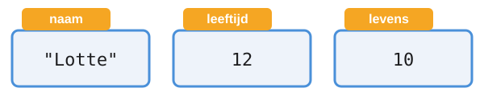

# Variabelen

Een variabele is een doos met een naam. Je bewaart er iets in: een getal, een stukje tekst, een lijst... Later gebruik je de waarde terug, of je verandert ze.



## Zo werkt het

```python
naam = "Lotte"     # tekst in de doos "naam"
leeftijd = 12      # een getal in de doos "leeftijd"
levens = 10
print(naam, "is", leeftijd)    # Lotte is 12
```

Het `=` teken betekent **"steek in de doos"**, niet "is gelijk aan". Python rekent eerst alles rechts van `=` uit. Daarna gaat het resultaat in de doos links.

## Een waarde veranderen

```python
levens = 10
levens = levens - 1    # neem de waarde (10), doe -1, steek 9 terug in de doos
print(levens)          # 9
levens += 5            # kort voor: levens = levens + 5
print(levens)          # 14
```

Ook `-=`, `*=` en `/=` bestaan: `score *= 2` verdubbelt de score.

## Goede namen kiezen

- Alleen letters, cijfers en `_`, geen spaties: `te_raden_getal` is goed, `te raden getal` niet.
- Niet beginnen met een cijfer: `speler1` is goed, `1speler` niet.
- Hoofdletters tellen: `Levens` en `levens` zijn 2 verschillende dozen.
- Kies een naam die zegt wat erin zit: `score` is beter dan `x`.
- Een waarde die nooit verandert (een *constante*) schrijf je in HOOFDLETTERS: `VENSTER_BREEDTE = 800`.

## Let op

- Steek eerst iets in de doos voor je ze gebruikt. `print(score)` zonder `score = 0` ervoor geeft `NameError: name 'score' is not defined`.
- `"naam"` (met aanhalingstekens) is gewoon het woord naam. `naam` (zonder) is de doos.
- Een doos bevat maar 1 ding. Steek je er iets nieuws in, dan is het oude weg.

## Probeer het zelf

Maak variabelen `naam` en `leeftijd` met jouw gegevens en print ze. Verhoog daarna `leeftijd` met 1 en print opnieuw: zo oud ben je volgend jaar!
