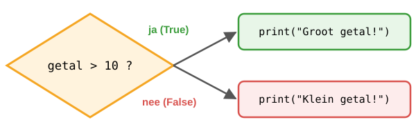

# Beslissen met if, elif en else

Met `if` (Engels voor "als") kiest je programma: **als** iets waar is, doe dan dit, **anders** doe dat.



## Zo werkt het

```python
getal = int(input("Geef een getal: "))
if getal > 10:
    print("Groot getal!")
else:
    print("Klein getal!")
print("Klaar")    # springt niet in: wordt altijd uitgevoerd
```

- Na de voorwaarde en na `else` komt een dubbelpunt `:`. Het `else`-blok mag je ook weglaten.
- De regels die bij `if` of `else` horen, springen **4 spaties** in (de Tab-toets). Zo weet Python wat bij het blok hoort.

## Meer dan 2 keuzes: elif

```python
if gok == geheim:
    print("Juist!")
elif gok < geheim:
    print("Hoger!")
else:
    print("Lager!")
```

Python test van boven naar onder en voert alleen het **eerste** blok uit dat waar is.

## Vergelijken

| Code | Betekenis |
|---|---|
| `a == b` | is gelijk aan (2 gelijktekens!) |
| `a != b` | is niet gelijk aan |
| `a < b` en `a > b` | kleiner dan, groter dan |
| `a <= b` en `a >= b` | kleiner of gelijk aan, groter of gelijk aan |
| `"a" in woord` en `"a" not in woord` | zit `"a"` (niet) in `woord`? |

Een vergelijking is `True` (waar) of `False` (niet waar). Combineer ze met `and` (allebei waar), `or` (minstens 1 waar) of `not` (omdraaien):

```python
if kamer == "Tuin" and "sleutel" in inventaris:
    print("Je bent ontsnapt!")
```

## Let op

- `=` steekt iets in een variabele, `==` vergelijkt. `if levens = 0:` geeft een `SyntaxError`.
- Dubbelpunt vergeten of verkeerd inspringen geeft een `SyntaxError` of `IndentationError`.
- Tekst is nooit gelijk aan een getal: `"5" == 5` is `False`. Gebruik `int()`.

## Probeer het zelf

Vraag een getal en print `even` of `oneven`. Tip: `getal % 2 == 0` (zie kaart 3).
