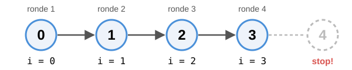

# Herhalen met een for-lus

Met een `for`-lus herhaal je code een aantal keer, of doe je iets voor **elk** ding in een rij: elke letter van een woord, elk element van een lijst...

## Een aantal keer herhalen: range()

```python
for i in range(4):
    print("Ronde", i)
```



- `range(4)` geeft de getallen `0, 1, 2, 3`. Dat zijn er 4, maar het begint bij **0** en de `4` zit er niet bij.
- `range(1, 6)` geeft `1, 2, 3, 4, 5`. `range(0, 10, 2)` telt per 2: `0, 2, 4, 6, 8`.
- `i` is een variabele die elke ronde een nieuwe waarde krijgt. Je mag ook een andere naam kiezen.

## Voor elk ding in een rij

```python
for letter in "kat":
    print(letter)            # k, dan a, dan t

kleuren = ["rood", "geel", "blauw"]
for kleur in kleuren:
    print("Ik hou van", kleur)
```

## Plaats en letter samen: enumerate()

```python
for positie, letter in enumerate("test"):
    print(positie, letter)   # 0 t, 1 e, 2 s, 3 t
```

## Een lus in een lus

Voor een rooster, zoals een speelbord, zet je een lus in een lus:

```python
for rij in range(3):
    for kolom in range(4):
        print(rij, kolom)    # 12 regels: 0 0, 0 1, 0 2, 0 3, 1 0, ... 2 3
```

## Let op

- Zet een dubbelpunt `:` op het einde, en laat de regels in de lus 4 spaties inspringen.
- Wat niet inspringt, wordt pas uitgevoerd na de lus.
- Een lus over een getal werkt niet: `for i in 5:` geeft een `TypeError`. Gebruik `range(5)`.

## Probeer het zelf

1. Print de tafel van 7, van `1 x 7 = 7` tot `10 x 7 = 70`.
2. Tel hoeveel keer de letter `e` voorkomt in een zin die de speler intypt.
