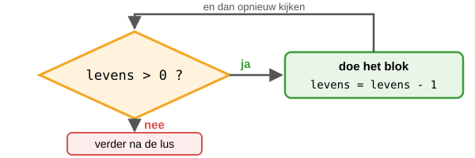

# Herhalen met een while-lus

Een `while`-lus (Engels voor "zolang") herhaalt code **zolang** iets waar is. Handig als je niet op voorhand weet hoeveel keer: tot de speler het woord raadt, tot het venster sluit...



## Zo werkt het

```python
levens = 3
while levens > 0:
    print("Je hebt nog", levens, "levens")
    levens = levens - 1
print("Game over!")
```

Voor elke ronde kijkt Python: is `levens > 0` nog waar? Ja: doe het blok (nog eens). Nee: ga verder na de lus.

## Oneindige lus en break

`while True:` stopt nooit vanzelf. Met `break` spring je uit de lus:

```python
geheim = "galgje"
while True:
    gok = input("Raad het woord: ")
    if gok == geheim:
        break                # stop de lus meteen
    print("Fout, probeer opnieuw.")
print("Goed geraden!")
```

## Stoppen met een variabele

In spelletjes houdt een variabele vaak bij of het spel moet stoppen:

```python
stoppen = False
while not stoppen:
    antwoord = input("Typ q om te stoppen: ")
    if antwoord == "q":
        stoppen = True
```

## for of while?

Weet je hoeveel keer, of loop je over een rij? Gebruik `for` (kaart 6). Herhaal je tot er iets gebeurt? Gebruik `while`.

## Let op

- Vergeet de dubbelpunt en het inspringen niet.
- Verander in de lus iets aan de voorwaarde, anders draait je programma voor altijd. Is dat toch gebeurd? Klik in de terminal en druk `CTRL-C`.

## Probeer het zelf

Laat de computer een geheim getal kiezen met `random.randint(1, 20)` (zie kaart 12). Laat de speler raden tot het juist is en zeg telkens "hoger" of "lager".
