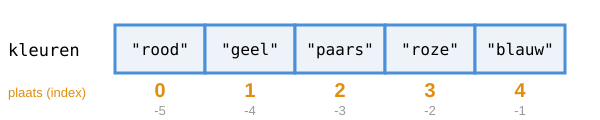

# Lijsten

Een lijst (Engels: *list*) is een variabele met meerdere dingen erin, netjes op een rij. Je schrijft een lijst tussen vierkante haakjes `[ ]`, met komma's ertussen.

```python
kleuren = ["rood", "geel", "paars", "roze", "blauw"]
```



## Elementen opvragen en veranderen

Net als bij strings heeft elk element een plaatsnummer (*index*). Je begint te tellen bij **0**.

```python
print(kleuren[0])      # rood
print(kleuren[-1])     # blauw (de laatste)
print(len(kleuren))    # 5
kleuren[1] = "groen"   # verander het element op plaats 1
print(kleuren)         # ['rood', 'groen', 'paars', 'roze', 'blauw']
```

## Toevoegen en verwijderen

| Code | Wat doet het? |
|---|---|
| `lijst = []` | maak een lege lijst |
| `lijst.append("x")` | voeg `"x"` achteraan toe |
| `lijst.remove("x")` | verwijder de eerste `"x"` |
| `lijst.pop()` | haal het laatste element eruit (en geef het terug) |
| `del lijst[0]` | verwijder het element op plaats 0 |
| `"x" in lijst` | zit `"x"` in de lijst? (`True` of `False`) |
| `lijst.extend(andere)` | plak een andere lijst achteraan |

## Een lijst doorlopen en een nieuwe vullen

```python
namen = ["Jan", "Sarah", "Hakim"]
lange_namen = []
for naam in namen:
    if len(naam) > 3:
        lange_namen.append(naam)
print(lange_namen)     # ['Sarah', 'Hakim']
```

## Let op

- Vergeet de komma's tussen de elementen niet.
- Een lijst met 5 elementen heeft plaatsen 0 tot 4. `kleuren[5]` geeft een `IndexError`.
- Een lijst mag alles bevatten: getallen, strings, en zelfs andere lijsten: `slang = [[10, 20], [20, 20]]`. Dan is `slang[1][0]` gelijk aan `20`.

## Probeer het zelf

Maak een lege boodschappenlijst. Vraag met een `while`-lus (kaart 7) telkens iets om toe te voegen, tot de speler `stop` typt. Print daarna de lijst en hoeveel dingen erop staan.
