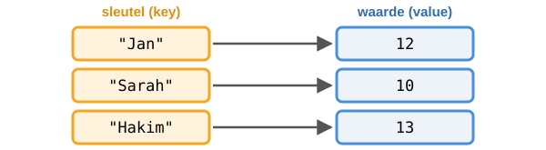

# Dictionaries (woordenboeken)

In een woordenboek zoek je een woord op en vind je de betekenis. Een *dictionary* werkt net zo: je zoekt een **sleutel** (*key*) op en krijgt de **waarde** (*value*) die erbij hoort.



## Zo werkt het

```python
leeftijden = {
    "Jan": 12,
    "Sarah": 10,
    "Hakim": 13,
}
print(leeftijden["Sarah"])   # 10
```

- Een dictionary staat tussen accolades `{ }`. Elk paar is `sleutel: waarde`, met een komma tussen de paren.
- Opzoeken doe je met vierkante haakjes en de sleutel: `leeftijden["Sarah"]`.

## Toevoegen, veranderen, verwijderen

```python
leeftijden["Lotte"] = 11       # nieuwe sleutel: wordt toegevoegd
leeftijden["Jan"] = 13         # bestaande sleutel: de waarde verandert
del leeftijden["Hakim"]        # verwijderen
if "Sarah" in leeftijden:      # bestaat deze sleutel?
    print("Sarah staat erin")
for naam in leeftijden:        # alle sleutels doorlopen
    print(naam, "is", leeftijden[naam])
```

## Lijst of dictionary?

In een **lijst** (kaart 9) zoek je op met een plaatsnummer: `kleuren[0]`. In een **dictionary** zoek je op met een naam, of iets anders: `kamers["Hal"]`, `knoppen[2, 3]`.

## Dictionaries in dictionaries

Een waarde mag zelf ook een dictionary of een lijst zijn. Zo maak je bv. de kamers van een spel:

```python
kamers = {
    "Hal": {"zuid": "Keuken", "voorwerp": "sleutel"},
    "Keuken": {"noord": "Hal"},
}
print(kamers["Hal"]["zuid"])   # Keuken
```

Data van een website (een *webservice*) ziet er vaak zo uit. Dat heet JSON.

## Let op

- Een sleutel opzoeken die niet bestaat, geeft een `KeyError`. Controleer eerst met `in`. Hoofdletters tellen: `"hal"` is niet `"Hal"`.

## Probeer het zelf

Maak een dictionary met 3 Nederlandse woorden als sleutel en hun Engelse vertaling als waarde. Vraag de speler een woord en print de vertaling, of "Dat woord ken ik niet".
