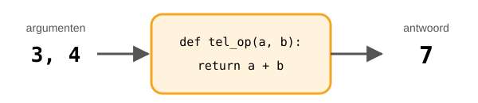

# Functies

Een functie is een stukje code met een naam. Je schrijft het 1 keer, en daarna gebruik (*roep*) je het zo vaak je wil. Zo moet je dezelfde code niet steeds opnieuw schrijven. Je kent al functies: `print()`, `input()`, `len()`...



## Een functie maken

```python
def hallo(naam):
    print(f"Hallo {naam}!")

hallo("Jan")       # Hallo Jan!
hallo("mama")      # Hallo mama!
```

- `def`, de naam van de functie, haakjes met de *argumenten*, en een dubbelpunt.
- De code van de functie springt 4 spaties in.
- `def` voert nog niets uit! De code loopt pas als je de functie aanroept: `hallo("Jan")`.

## Een antwoord teruggeven: return

```python
def tel_op(a, b):
    return a + b

uitkomst = tel_op(3, 4)
print(uitkomst)            # 7
```

Met `return` geeft de functie een antwoord terug. De functie stopt daar meteen.

## Een standaardwaarde voor een argument

```python
def spring(hoogte=10):
    print("Spring", hoogte)

spring()          # Spring 10
spring(25)        # Spring 25
```

## Een variabele van buiten veranderen: global

Een variabele die je **in** een functie een waarde geeft, bestaat alleen in die functie. Wil je een variabele van buiten de functie veranderen? Zeg dat dan met `global`:

```python
score = 0

def punt_erbij():
    global score
    score = score + 1
```

## Let op

- Maak eerst de functie (`def`) en roep ze pas daarna aan. Anders krijg je een `NameError`.
- Vergeet de haakjes niet: `hallo` zonder haakjes voert niets uit.

## Probeer het zelf

Schrijf een functie `is_even(getal)` die `True` of `False` teruggeeft. Test ze met een paar getallen.
