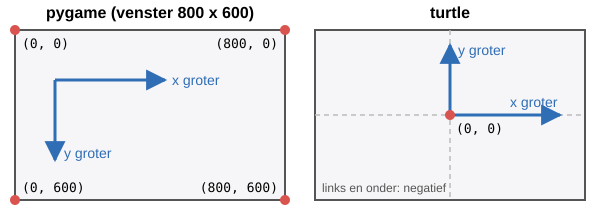

# Coördinaten en kleuren

Om iets op het scherm te tekenen, moet de computer weten **waar** (de coördinaten) en in **welke kleur**.

## Coördinaten: (x, y)

Een plaats op het scherm schrijf je als `(x, y)`. De getallen zijn *pixels*: de kleine puntjes waaruit je scherm bestaat.

- **x** is horizontaal: hoe ver naar rechts.
- **y** is verticaal: hoe ver naar beneden (pygame) of naar boven (turtle).



| | pygame en tkinter | turtle |
|---|---|---|
| Waar is (0, 0)? | linksboven | in het midden |
| Grotere y | lager op het scherm | hoger op het scherm |

## Rekenen met coördinaten

Een venster van 800 breed en 600 hoog (pygame):

```python
VENSTER_BREEDTE = 800
VENSTER_HOOGTE = 600
x = VENSTER_BREEDTE // 2    # 400: het midden
y = VENSTER_HOOGTE // 2     # 300: het midden
x = x + 5                   # 5 pixels naar rechts
y = y - 5                   # 5 pixels omhoog (in pygame!)
```

Bij een rechthoek is `(x, y)` meestal de **linkerbovenhoek**, bij een cirkel het **midden**.

## Kleuren: RGB

Een scherm maakt elke kleur door **r**ood, **g**roen en **b**lauw licht te mengen. Een kleur schrijf je als 3 getallen `(rood, groen, blauw)`, elk van 0 (niets) tot 255 (helemaal). Zoek "color picker" in Google om er meer te vinden.

| Kleur | RGB | Kleur | RGB |
|---|---|---|---|
| zwart | `(0, 0, 0)` | wit | `(255, 255, 255)` |
| rood | `(255, 0, 0)` | geel | `(255, 255, 0)` |
| groen | `(0, 255, 0)` | paars | `(128, 0, 128)` |
| blauw | `(0, 0, 255)` | grijs | `(128, 128, 128)` |

## Let op

- In turtle zijn de RGB-getallen kommagetallen van 0 tot 1: `t.color(1, 0, 0)` is rood. Je mag ook namen gebruiken: `t.color("red")`.
- Na `/` krijg je een kommagetal. Gebruik voor posities liever `//` of `int()`.

## Probeer het zelf

Een pygame-venster is 800 breed en 600 hoog. Waar moet de linkerbovenhoek van een rechthoek van 100 breed en 50 hoog staan, zodat de rechthoek precies in het midden staat?
