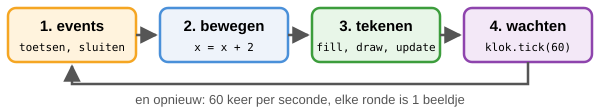

# Een spel met pygame: de game loop

`pygame` is een module om spelletjes te maken (installeren: `pip install pygame`, kaart 12). Elk pygame-spel heeft een **game loop**: een `while`-lus die 60 keer per seconde dezelfde 4 stappen doet.



## De basis van elk spel

```python
import pygame
pygame.init()
venster = pygame.display.set_mode((800, 600))   # breedte, hoogte
klok = pygame.time.Clock()
x = 0

stoppen = False
while not stoppen:
    # 1. Events (gebeurtenissen) bekijken
    for event in pygame.event.get():
        if event.type == pygame.QUIT:      # venster gesloten
            stoppen = True
    # 2. Dingen laten bewegen
    x = x + 2
    # 3. Alles tekenen: eerst fill(), dan tekenen, dan update()
    venster.fill((0, 0, 0))                                      # alles zwart
    pygame.draw.circle(venster, (255, 255, 255), (x, 300), 10)   # een bal
    pygame.display.update()                                      # toon het beeld
    # 4. Wachten, zodat de lus 60 keer per seconde loopt (anders veel te snel!)
    klok.tick(60)
```

## Toetsen

- 1 keer als de toets net ingedrukt wordt (bv. springen), in de `for event`-lus:  
  `if event.type == pygame.KEYDOWN and event.key == pygame.K_SPACE:`
- Zolang de toets ingedrukt blijft (bv. bewegen): `if pygame.key.get_pressed()[pygame.K_UP]:`
- Andere toetsen: `pygame.K_DOWN`, `pygame.K_LEFT`, `pygame.K_RIGHT`, `pygame.K_a` tot `pygame.K_z`...

## Tekenen (zie kaart 14 voor coördinaten en kleuren)

```python
pygame.draw.rect(venster, kleur, (x, y, breedte, hoogte))   # (x, y) is linksboven
pygame.draw.circle(venster, kleur, (x, y), straal)         # (x, y) is het midden
afbeelding = pygame.image.load("vogel.png")
venster.blit(afbeelding, (x, y))                           # (x, y) is linksboven
```

## Probeer het zelf

Laat de bal terug naar links rijden als hij de rechterrand raakt. Tip: gebruik een variabele `snelheid` en draai ze om met `snelheid = snelheid * -1`.
