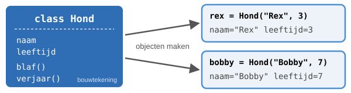

# Klassen en objecten

Een **klasse** (*class*) is een bouwtekening. Met 1 bouwtekening maak je zoveel **objecten** als je wil. Elk object onthoudt zijn eigen gegevens, maar ze kunnen allemaal hetzelfde.



## Een klasse maken

```python
class Hond:
    def __init__(self, naam, leeftijd):
        self.naam = naam            # elk object onthoudt zijn eigen naam
        self.leeftijd = leeftijd

    def blaf(self):
        print(f"{self.naam} zegt: Waf!")

    def verjaar(self):
        self.leeftijd += 1
```

- `class`, een naam met een hoofdletter, en een dubbelpunt.
- Functies in een klasse heten *methodes*. Hun eerste argument is altijd `self`: dat is "het object zelf". Vergeet je `self`, dan krijg je een `TypeError`.
- `__init__` (2 liggende streepjes voor en achter) loopt als je een nieuw object maakt. `self.naam` is een variabele die bij het object hoort (een *attribuut*).

## Objecten maken en gebruiken

```python
rex = Hond("Rex", 3)
bobby = Hond("Bobby", 7)

rex.blaf()               # Rex zegt: Waf!
bobby.blaf()             # Bobby zegt: Waf!
rex.verjaar()
print(rex.leeftijd)      # 4
print(bobby.leeftijd)    # 7: bobby verandert niet mee
```

`self` geef je niet mee als je een methode aanroept. Dat doet Python zelf.

## Een klasse uitbreiden: subklasse

Een subklasse kan alles wat een andere klasse kan, en meer. Zo maak je in pygame je eigen *sprites*:

```python
class Vogel(pygame.sprite.Sprite):
    def __init__(self, x, y):
        pygame.sprite.Sprite.__init__(self)    # eerst de Sprite klaarmaken
        self.image = pygame.image.load("vogel.png")
```

## Probeer het zelf

Maak een klasse `Speler` met een `naam`, een `score` die begint op 0, en een methode `punt()` die de score met 1 verhoogt. Maak 2 spelers en geef ze elk een paar punten.
